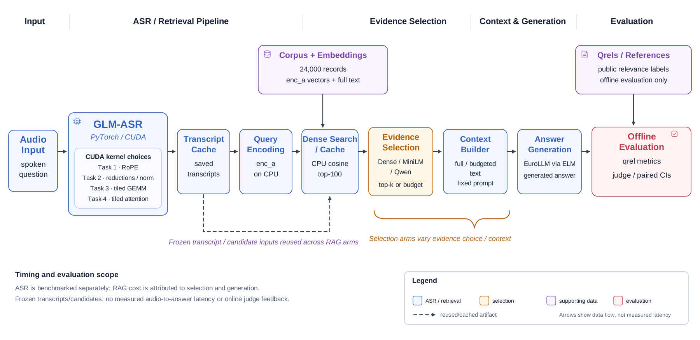

# Report figures

## System architecture

- Vector PDF used by LaTeX:
  `report/latex_template/figures/ASR_RAG_System_Architecture_No_Title.pdf`.
- Editable source: the group-supplied
  `report/latex_template/figures/ASR_RAG_System_Architecture_No_Title.svg`,
  pulled in commit `07fdab9`. It is included without modifying the supplied SVG;
  its title is omitted in favour of the report's Figure 1 caption.
- Conversion: install `CairoSVG==2.9.1` and PyMuPDF in a Python environment, then
  run `python report/convert_architecture_svg.py` from the repository root.
  The PDF contains vector shapes and text, not a raster screenshot.
  CairoSVG preserves SVG marker arrowheads; direct MuPDF SVG import loses them.
  CairoSVG also requires the platform Cairo library.
- Source/conversion/asset hashes and converter versions:
  `rag/results/report-architecture/svg-summary.json`.
- Solid arrows show data flow; dashed arrows denote cached/reused artifacts.
- Qrels do **not** feed online evidence selection; no judge-to-selector tuning
  loop is shown.
- Transcript/candidate caches mark the controlled RAG experimental boundary.
  Timing notes distinguish standalone ASR benchmarks from attributed RAG stage
  costs. The diagram does not claim measured audio-to-answer latency.
- Top-k generation uses full selected records; token-budget arms may use
  document prefixes. The context-builder label deliberately covers both.
- The previous `draw_system_architecture.py` and `figures/system-architecture.*`
  are retained as superseded assets; they are no longer included by LaTeX.
  Their original provenance remains in `report-architecture/summary.json`.
  The earlier titled SVG in `latex_template/` is likewise superseded.

## Quality versus attributed stage cost

- Vector PDF: `report/latex_template/figures/qwen-quality-cost.pdf`.
- Generator: `report/plot_quality_cost.py`.
- Data/provenance: `rag/results/report-quality-cost/summary.json`.
- Practice/dev are separate panels with full 0–1 judge-score axes.
  Annotated intervals are for paired score differences, not individual arms or
  timing. The dev interval includes zero.

## Layout and course requirements

Adding the architecture without moving content exceeded the six-page body
limit. The four selected ASR answers were therefore moved **without changing
their content** into `report/latex_template/asr_selected_answers.tex`, included
as Appendix A. Their numbered labels remain linked from the introduction.
Core ASR implementation, correctness, profiling, GEMM/cuBLAS comparison and
end-to-end findings remain in the main body.

This follows the course announcement permitting selected answers anywhere in
the report. Optional Try This experiments were not added.
