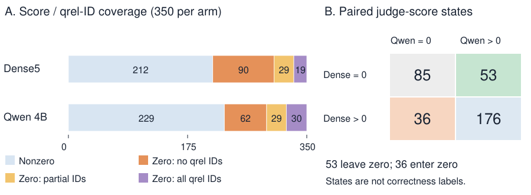

# Report figures

## System architecture

- **Main-body version:** [audio-rag-architecture.pdf](latex_template/figures/audio-rag-architecture.pdf).
  Edit the source in draw.io using `report/latex_template/figures/audio-rag-architecture.drawio`.
- The two evidence lists show original dense ranks for practice query
  `q_ce474d8f8d548797`, from
  `rag/results/qwen4-retrieval-3724174/full/rankings.jsonl`.
- Solid arrows show the request path. Dashed arrows mark storage reads.
  Both arms share the saved transcript and dense candidate pool, then read
  the full text of the five selected records for generation.
- Earlier versions include `architecture-report.pdf` (the two-row reflow),
  `ASR_RAG_System_Architecture_No_Title.pdf` (the group-supplied design) and
  `system-architecture.pdf`. Their generation and conversion records are
  under `rag/results/report-architecture/`.

## Quality versus attributed stage cost

- Vector PDF: `report/latex_template/figures/qwen-quality-cost.pdf`.
- Generator: `report/plot_quality_cost.py`.
- Data/provenance: `rag/results/report-quality-cost/summary.json`.
- Practice/dev are separate panels with full 0–1 judge-score axes.
  Annotated intervals are for paired score differences, not individual arms or
  timing. The dev interval includes zero.

## Judge-zero composition and paired transitions

- Main-body vector PDF: `report/latex_template/figures/practice-zero-scores.pdf`.
- Generator: `python3 report/plot_zero_scores.py`, after running
  `python3 rag/extensions/analyze_practice_errors.py`.
- Input: `rag/results/practice-error-analysis-v1/summary.json`;
  arithmetic/source/asset hashes: `rag/results/report-zero-scores/summary.json`.
- Each left-panel bar includes all 350 practice queries, not just zero-score
  queries. Qrel-ID coverage subdivides zero-score answers only.
- The right panel preserves query pairing: 85 zero/zero, 53 zero/nonzero,
  36 nonzero/zero, 176 nonzero/nonzero.
- These are existing judge-score states, not verified correctness, error rates,
  causal effects or new judgments. No dev diagnostic is added.

## Layout and course requirements

Adding the architecture without moving content exceeded the six-page body
limit. The four selected ASR answers were therefore moved **without changing
their content** into `report/latex_template/asr_selected_answers.tex`, included
as Appendix A. Their numbered labels remain linked from the introduction.
Core ASR implementation, correctness, profiling, GEMM/cuBLAS comparison and
end-to-end findings remain in the main body.

This follows the course announcement permitting selected answers anywhere in
the report. Optional Try This experiments were not added.
