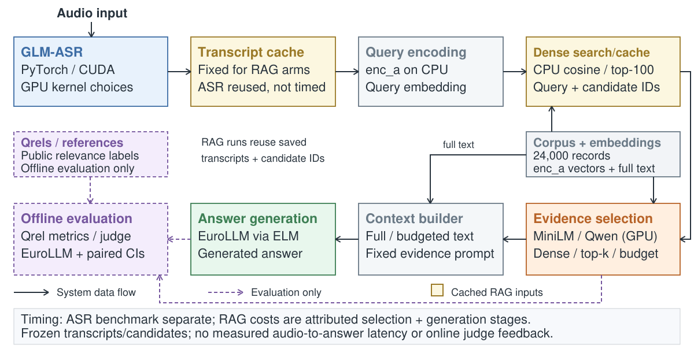

# Report figures

## System architecture

- Vector PDF used by LaTeX:
  `report/latex_template/figures/system-architecture.pdf`.
- Editable generator: `report/draw_system_architecture.py`.
  Edit `NODES` and `EDGES`, then run `python3 report/draw_system_architecture.py`
  from the repository root. The PDF uses text/lines/shapes, not a raster screenshot.
- Source/provenance: `rag/results/report-architecture/summary.json` records node
  and edge definitions, implementation hashes, and PDF/PNG hashes.
- Solid arrows show system data flow; purple dashed arrows carry rankings,
  answers and public references to offline evaluation.
- Qrels do **not** feed online evidence selection; no judge-to-selector tuning
  loop is shown.
- Transcript/candidate caches mark the controlled RAG experimental boundary.
  Timing notes distinguish standalone ASR benchmarks from attributed RAG stage
  costs. The diagram does not claim measured audio-to-answer latency.
- Top-k generation uses full selected records; token-budget arms may use
  document prefixes. The context-builder label deliberately covers both.

## Quality versus attributed stage cost

- Vector PDF: `report/latex_template/figures/qwen-quality-cost.pdf`.
- Generator: `report/plot_quality_cost.py`.
- Data/provenance: `rag/results/report-quality-cost/summary.json`.
- Practice/dev are separate panels with full 0–1 judge-score axes.
  Annotated intervals are for paired score differences, not individual arms or
  timing. The dev interval includes zero.

## Layout and course requirements

Adding the architecture without moving content exceeded the six-page body
limit. The four selected ASR answers were therefore moved **without changing
their content** into `report/latex_template/asr_selected_answers.tex`, included
as Appendix A. Their numbered labels remain linked from the introduction.
Core ASR implementation, correctness, profiling, GEMM/cuBLAS comparison and
end-to-end findings remain in the main body.

This follows the course announcement permitting selected answers anywhere in
the report. Optional Try This experiments were not added.
